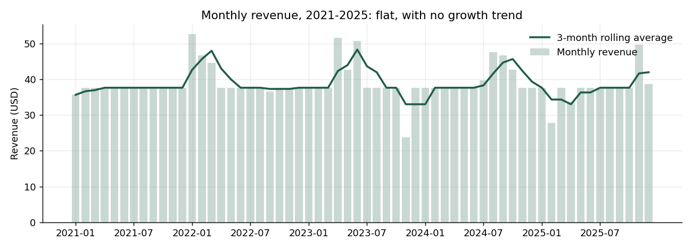
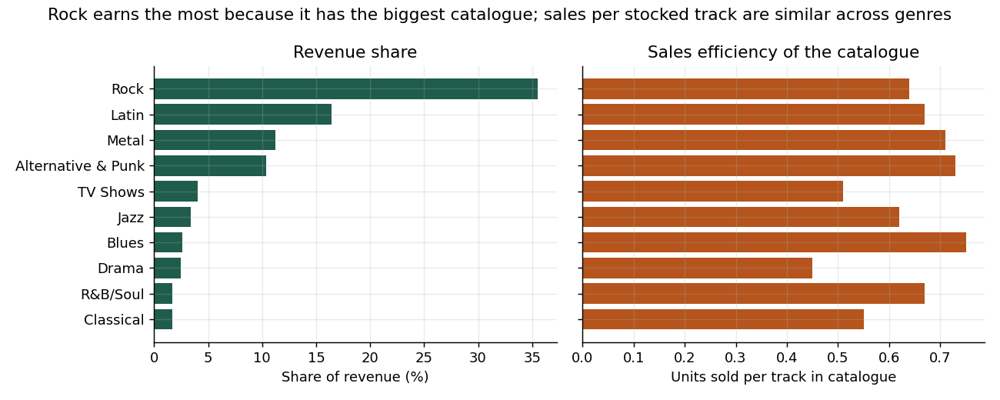
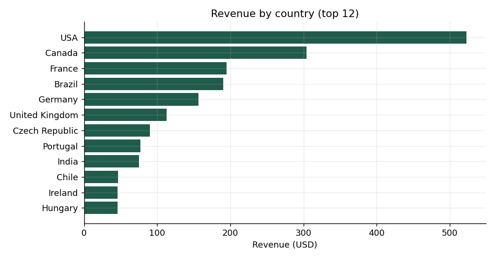

# SQL Business Analytics — Chinook Digital Music Store

Fifteen business questions answered in pure SQL against the **Chinook** sample database, a model
of a digital music store with customers, invoices, tracks, genres, artists and staff. Each
question is one `.sql` file. A small Python runner executes them, saves every result as CSV, and
draws the charts.

The SQL covers **CTEs, window functions (`LAG`, `RANK`, `ROW_NUMBER`, `NTILE`, running and
rolling aggregates), recursive CTEs, self-joins, anti-joins, conditional aggregation and
reconciliation checks.**

## How to run

```bash
pip install -r requirements.txt
python src/run_queries.py
```

Outputs go to `results/` (one CSV per query, plus [`results/RESULTS.md`](results/RESULTS.md)
with every table) and to `figures/`.

## Questions and what the data says

| # | Question | Techniques |
|---|---|---|
| 01 | Year-over-year revenue, order count and average order value | `GROUP BY`, `LAG` |
| 02 | Monthly revenue with a 3-month rolling average and running total | window frames |
| 03 | Revenue, customers and revenue share by country | scalar subquery |
| 04 | Genre revenue against catalogue size (sales per stocked track) | multi-CTE, `SUM() OVER ()` |
| 05 | Top 10 artists and their cumulative (Pareto) share | `RANK`, cumulative window |
| 06 | Customer lifetime value, tenure and spend quartile | `NTILE`, date arithmetic |
| 07 | Revenue managed by each support rep | joins across 3 tables |
| 08 | Days between a customer's purchases | `LAG ... PARTITION BY` |
| 09 | Basket-size distribution | aggregate over aggregate |
| 10 | Genre pairs bought together (cross-sell) | self-join |
| 11 | Share of the catalogue that has never sold | anti-join |
| 12 | Favourite genre in each country | `ROW_NUMBER` top-1 per group |
| 13 | RFM-style customer segments | `NTILE` scoring, `CASE` |
| 14 | Data-quality audit (reconciliation, orphans, nulls) | `UNION ALL` of checks |
| 15 | Org chart and reporting chains | recursive CTE |

### Key findings

- **Revenue is flat.** It runs at about $450–$480 a year over 2021–2025, with a range of −5.6% to
  +7.1% YoY and no trend. Average order value stays in a narrow $5.42–$5.80 band.
- **The US and Canada bring in 35.6% of revenue.** Revenue *per customer* is almost the same in
  every country ($37–$47), so the differences between markets come from the number of customers,
  not from how much each customer spends.
- **Rock earns 35.5% of revenue, but mainly because it is 37% of the catalogue.** Units sold per
  stocked track sit between 0.45 and 0.77 for every major genre, so no genre is unusually
  efficient. Rock also anchors cross-selling: the three most common genre pairs all include it.
- **About 43% of tracks have never sold**, and the figure rises to 52% for protected video files.
  That makes the case for pruning or promoting the long tail.
- **The top 10 artists bring in only 31% of revenue.** Sales are spread widely rather than
  concentrated in a few hits.
- **The three support reps split revenue evenly** (31–36% each), with a similar value per customer.

### A note on the data itself

Several results are *too* regular for real behaviour, and an analyst should report that rather
than over-interpret it:

- **Every customer has exactly 7 orders** (query 06 and the segment table in 13).
- Basket sizes take only six values (1, 2, 4, 6, 9 and 14 tracks), and five of them account for
  exactly 59 invoices each (query 09).
- The gaps between purchases never fall below 41 days (query 08).

Chinook is a generated teaching dataset, so the **frequency** side of any RFM analysis is
meaningless here, and the segments in query 13 effectively rest on recency and spend alone. The
data-quality audit (query 14) found no reconciliation errors. Invoice totals match their lines,
and there are no orphaned records. The only gaps are 29 customers with no state recorded and
977 tracks with no composer.

## Charts





## Project layout

```
sql/               15 queries, one business question each
src/run_queries.py runs every query and writes results/ and figures/
data/chinook.sqlite
results/           CSV output per query + RESULTS.md
figures/           charts
```

## Data

The Chinook database is by Luis Rocha ([lerocha/chinook-database](https://github.com/lerocha/chinook-database)),
used under its open licence. This repository uses the SQLite build, which has invoices dated
2021–2025.
